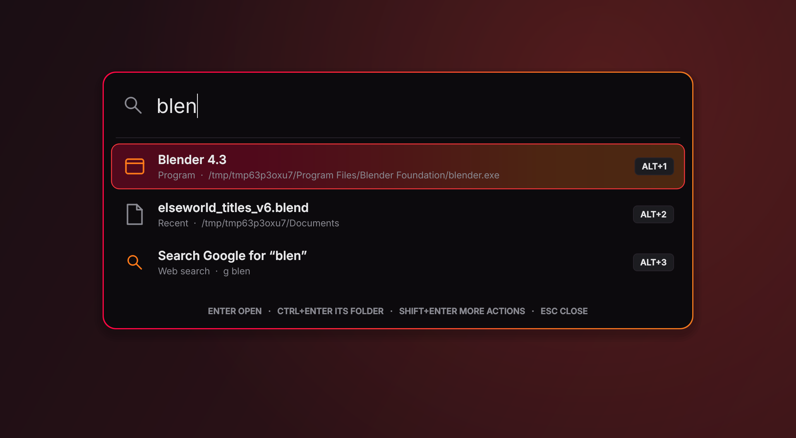
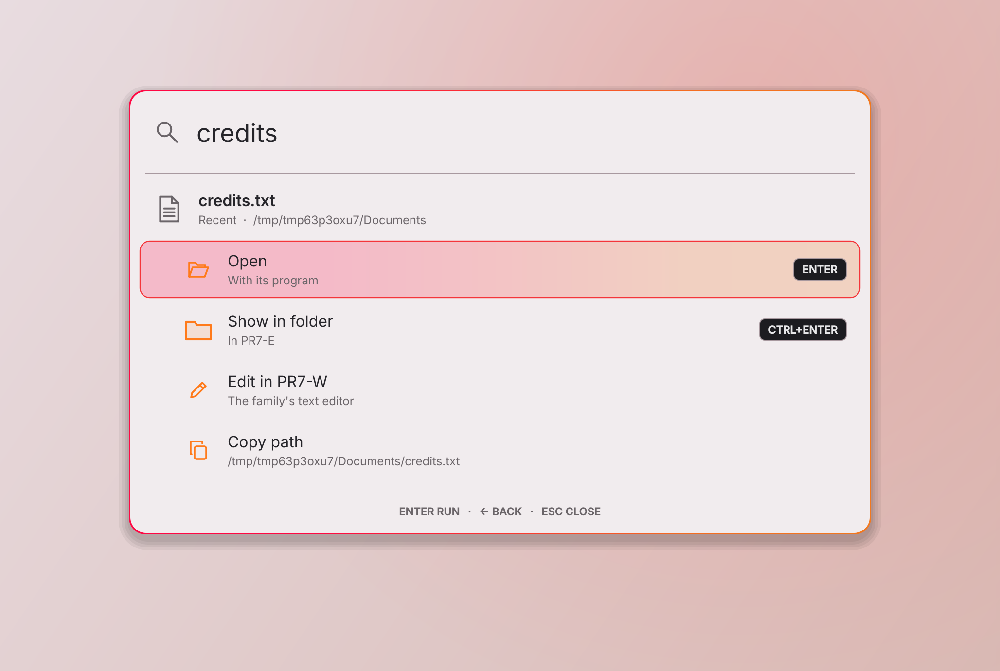
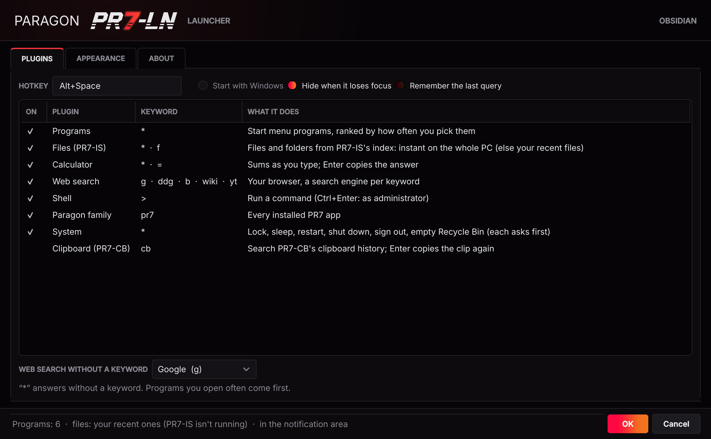

# Paragon PR7-LN

A launcher that opens things from one key, the way **Flow Launcher** works, in the Paragon family look (PR7-Z ...
PR7-DB, PR7-UN). Python and PySide6.

## What it does

- **Alt+Space** from any program opens one search line in the middle of the screen. Type a few letters and Enter
  opens the top result. It hides again when you click elsewhere.
- **Programs:** both Start menus (yours and everyone's), uninstallers left out. Matches by name start, word start,
  initials ("vsc" finds Visual Studio Code) or letters in order. Programs you pick often move up.
- **Files:** with PR7-IS's index service running, every file and folder on the PC answers at once. Without it you get
  your recent files. `f` searches files only.
- **Calculator:** a sum is answered as you type (`3840*2160`, `sqrt(2)`, `2^10`), or after `=`. Enter copies the
  answer.
- **Web search:** `g`, `ddg`, `b`, `wiki`, `yt` plus words. A web search is always offered last.
- **Shell:** `>` runs a command in a console window; Ctrl+Enter runs it as administrator.
- **Paragon family:** `pr7` lists the installed family apps.
- **System:** Lock, Sleep, Restart, Shut down, Sign out, Empty Recycle Bin, Settings. Each one that can't be undone
  asks first.
- **Clipboard (PR7-CB):** `cb` searches PR7-CB's history (read only). It's off until you switch it on in Settings.
- **Keys:**
  - Up / Down choose a result, and Enter opens it.
  - Ctrl+Enter opens a file's or program's folder (in PR7-E when it's installed).
  - Shift+Enter or Right lists more actions: Open, Show in folder, Run as administrator, Edit in PR7-W, Open in PR7-R
    / P / M / Z / DB / HX, Copy path.
  - Alt+1..9 opens that row; Tab completes the name; Esc closes.
- **Settings:** the key, Start with Windows, Hide when it loses focus, Remember the last query, plugins on or off,
  the web search used without a keyword, the finish.

## Building

`pip install -r requirements.txt -r requirements-dev.txt`, `python -m pytest`, `pyinstaller pr7ln.spec`, then Inno Setup:
`iscc /DAppVersion=x.y.z installer\pr7ln.iss`.
